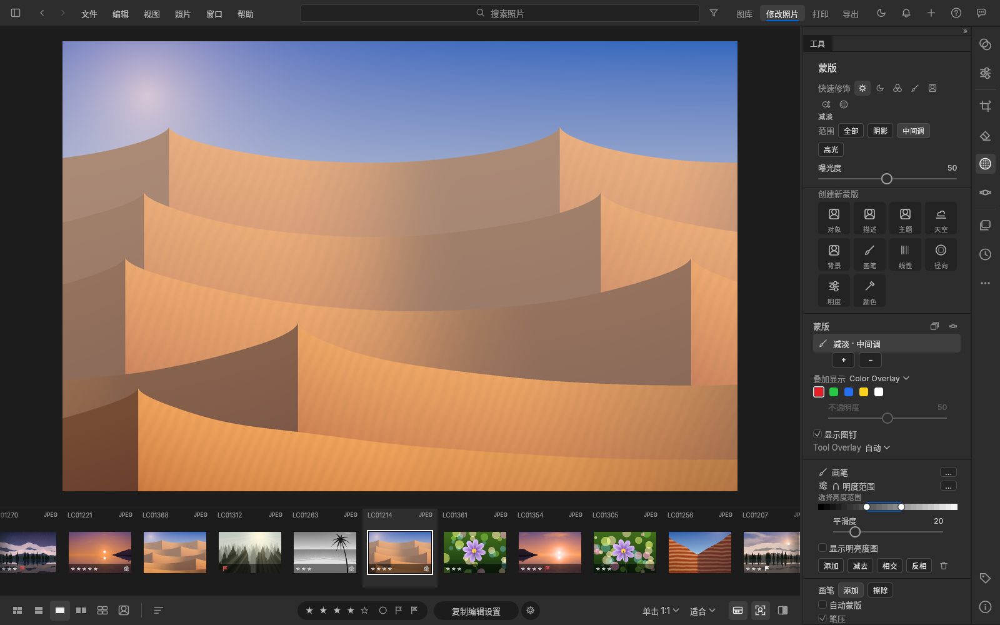
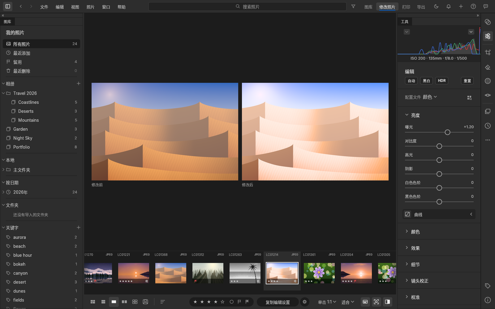
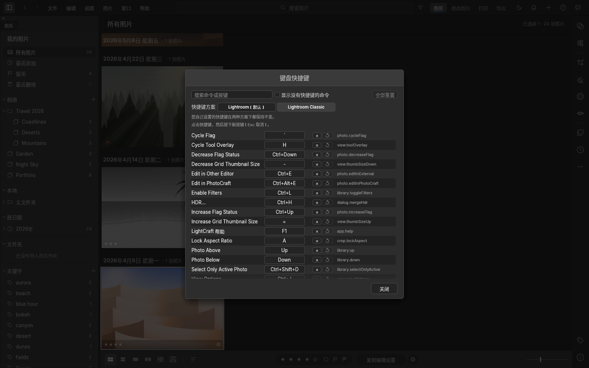
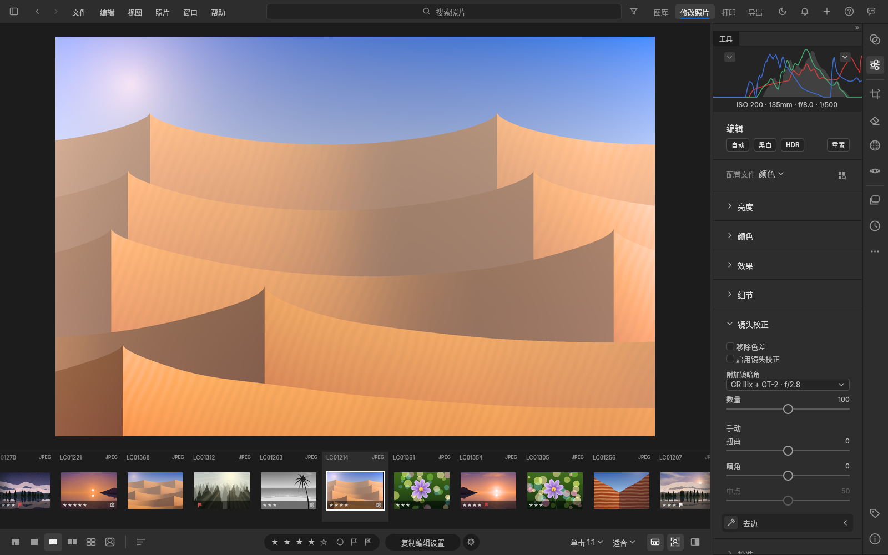

# LightCraft 附加扩展（Lightroom Classic 式模块栏、打印模块、导出后打开、修改前/修改后修复、LrC 快捷键、快速修饰工具、附加镜暗角校正）

这是给 [LightCraft](https://github.com/storytold/lightcraft) 打的一组补丁和一个构建脚本。它在**官方发布版 v0.20.0** 上加了下面这些功能，引擎、照片数据和图库格式都不动。

- **顶栏右上角的模块栏：图库｜修改照片｜打印｜导出**，操作逻辑沿用 Lightroom：
  - **图库**：照片网格和左侧面板，用来选图、打星、加旗标；
  - **修改照片**：放大视图加 Edit 调整面板，已经在用的裁剪、蒙版、移除等工具会保持打开；
  - **打印**：整个窗口显示打印设置和页面预览，见下文；
  - **导出**：打开导出对话框。
  - 快捷键和 Lightroom Classic 一致：Ctrl/⌘+Alt+1 图库，Ctrl/⌘+Alt+2 修改照片，Ctrl/⌘+Alt+6 打印。“窗口”菜单里也能切换，当前模块会打勾。
- **打印模块**
  - **照片尺寸 ▸ 按长边设定尺寸**：默认开启，长边 **10 英寸**。每张照片单独一页、居中，保持自己裁剪后的比例。只改打印版面，**不改照片本身**：调整、裁剪、文件都不变。
    - 可以直接输入长边，或点 5 / 6 / 8 / 10 / 12 / 16 英寸快捷按钮；
    - 右侧会显示实际打印尺寸，例如 10.00 × 6.67 in；
    - 纸张放不下时会等比缩小并给出提示。
  - **纵向 / 横向**、纸张大小、页边距。
  - **色彩管理**：打印机/纸张 ICC 配置文件，或“由打印机管理（sRGB / Adobe RGB）”；渲染方式（可感知 / 相对）；黑场补偿；打印亮度和对比度；打印锐化（介质：哑光 / 光面）；16 位输出；分辨率。
  - 关闭“按长边设定尺寸”后，LightCraft 原有的全部打印版式都会出现：单张、联系表、图片包、自定义，另有模板、参考线等。
- **导出后打开**（导出对话框 ▸ “导出后”），对应 LrC 的“后期处理”：
  - 可选：无操作（默认）/ 在 Finder（Windows：文件资源管理器）中显示 / 在 PhotoCraft 中打开 / 在其他应用程序中打开…；
  - 选“在其他应用程序中打开…”后，下面会出现“应用程序”一栏，默认填 设置 ▸ 常规 ▸ External Editing 里的外部编辑器（比如 Photoshop），也可以点按钮另选；
  - 这个选择会随“使用上次设置导出”（⌥⇧⌘E）和导出预设一起保存。所以“导出到桌面文件夹，同时用 Photoshop 打开”可以存成一个预设，以后一键完成。
- **修改前 / 修改后修复**：
  - 修改前还没渲染好时，不再拿修改后的画面顶替（以前两边看起来一样，就是这个原因）。这时修改前那一侧是灰色，写着“正在渲染修改前…”；渲染失败也会明确提示；
  - 在网格、比较视图里按 Y（或 ⇧Y、⌥Y、⌥⇧Y），直接进入“修改照片”的放大视图，并打开对应的对比布局；
  - 分屏模式补上“修改前 / 修改后”标签；按 \ 显示原图时，“修改前”标记更醒目；
  - “将修改前设置复制到修改后”和“交换”保留当前的裁剪和方向。
- **Lightroom Classic 快捷键方案**：在 帮助 ▸ 键盘快捷键（或 设置 ▸ 常规 ▸ 键盘）里一键切换为“Lightroom Classic”。切换后：
  - E 放大、D 修改照片、C 比较、R 裁剪、Q 污点去除（移除）、K 画笔、M / ⇧M 线性 / 径向渐变、⇧W 蒙版、L 关灯、I 信息叠加；
  - ⌘E 在外部编辑器（Photoshop）中编辑、⌥⌘E 在 PhotoCraft 中编辑、⇧⌘E 导出、⌘U 自动、⇧⌘S 同步设置；
  - ⌘N 在修改照片时是新建版本（快照），在图库里是新建相册（收藏夹）；
  - 你自己改过的快捷键在两种方案下都优先。完整对照表见 [docs/classic-keymap.md](docs/classic-keymap.md)。默认仍是原来的方案，不切换就不会有任何变化。
- **快速修饰工具**（修改照片 ▸ 蒙版面板顶部的“快速修饰”一行）：
  - **减淡 / 加深**：新建一个画笔蒙版，曝光 ±1 EV（强度可调）。范围可选 阴影 / 中间调（默认）/ 高光 / 全部，用亮度范围限制；
  - **海绵**：去色或加色，流量可调；
  - **快速选择**：开着“自动蒙版”的画笔，沿边缘涂抹即可选中；附“选择主体”按钮；
  - **对象选择**：调用 LightCraft 已有的 AI 对象选择（需要时会提示下载模型）；
  - **仿制图章**：移除工具的“仿制”模式，按住 ⌥/Alt 点击设定取样点，“对齐”选项和 PS 一样；
  - **快速蒙版**：红色 50% 叠加显示当前蒙版，再按一次恢复原来的叠加设置；
  - 快捷键：⇧B 在减淡 → 加深 → 海绵 间切换，⇧W 快速选择 / 对象选择，⇧Q 仿制图章，Q 快速蒙版（在 Classic 方案下 Q 是污点去除、⇧W 是蒙版，这两个工具就不占键，可在快捷键设置里自己指定）；
  - 都是非破坏性的局部调整，每次操作只算一步撤销，可以随时在蒙版面板里修改或删除。
- **附加镜暗角校正**（修改照片 ▸ 镜头校正 ▸ 附加镜暗角），针对 GR IIIx + GT-2 强制 60mm 这类情况：
  - 用一张自己拍的平场照测出增距镜的暗角，存成配置（例如“GR IIIx + GT-2 · f/2.8”），之后一键校正；
  - 叠加在原有的镜头校正之上，裸镜头部分不会被重复校正；带“数量”滑块，最多提亮 4 档；
  - 四角完全没光的部分会给出提示，建议裁掉；
  - 可以同步、复制粘贴、存进预设，也能设成导入时自动应用。详见 [docs/gt2-converter-vignetting.zh-CN.md](docs/gt2-converter-vignetting.zh-CN.md)。
- **中文打印界面**：补齐了打印界面的简体和繁体中文。原来 “Paper” 被译成“纸白”，纸张方向显示成“人像 / 横向”，现在分别是“纸张”和“纵向 / 横向”。
- **启动时不再自动检查官方更新**：官方版本没有这些功能，更新会把它们覆盖掉。升级方法见下文。“帮助 ▸ 检查更新”手动入口仍在，但安装它就会回到官方版。
- **支持打开 HEIC/HEIF 照片**：和官方发布版一致。上游默认不开启，是出于 HEVC 专利方面的考虑，让发行方自己决定；构建脚本按官方发布版的做法开启它。

| 图库 | 修改照片 |
|---|---|
|  |  |
| **打印**：横向 Letter 纸，长边 10 英寸，居中 | **窗口较窄时**：模块栏收成一个下拉按钮 |
|  |  |
| **快速修饰 ▸ 减淡**：蒙版面板顶部一行工具，减淡只作用于中间调 | **修改前 / 修改后**：在图库网格里按 Y，直接进入左右对比 |
|  |  |
| **快捷键方案 ▸ Lightroom Classic**：⌘E 在外部编辑器中编辑，⌥⌘E 在 PhotoCraft 中编辑 | **镜头校正 ▸ 附加镜暗角**：选用平场照生成的配置，四角提亮 |
|  |  |

截图由命令行工具在无界面模式下渲染，用的是演示图库，界面语言为简体中文。在 Linux 上 ⌘ 显示为 Ctrl。“导出后”一栏没有截图：无界面模式下系统没有提供“打开 / 在文件夹中显示”服务，这一栏会按设计隐藏。在桌面版中它会显示。

> **关于打印输出**：LightCraft 的打印目前只能输出 **PDF**（16 位，嵌入 ICC 配置文件）。“打印到 PDF…”之后，用系统的 PDF 阅读器（macOS 预览、Adobe Acrobat）或 PhotoCraft 打开再送打印机。**在打印对话框里一定要选“实际大小 / 100%”，不要选“适合页面”**，否则 10 英寸会被缩放。

## 构建和安装

需要：Git，以及 Rust 工具链（安装 [rustup](https://rustup.rs) 即可，要求 Rust 1.95 或更高）。macOS 还要 Xcode 命令行工具（`xcode-select --install`），Windows 还要 Visual Studio C++ 生成工具。

首次构建会下载源码和依赖，4 核电脑大约要 30–60 分钟，`build/` 目录会占用约 10 GB。

### macOS

```bash
git clone -b ccr-45d7b05e-5o74gq https://github.com/2751833085/LightCraft-additional-extensions
cd LightCraft-additional-extensions
scripts/build.sh --package
```

完成后打开 `build/lightcraft/dist/release/` 里的 `.dmg`，把 LightCraft 拖进“应用程序”。

这个 DMG 是本机自签名（ad-hoc）的，只能在构建它的这台 Mac 上直接打开。第一次打开如果被系统拦截，在“系统设置 ▸ 隐私与安全性”里点“仍要打开”。

只想直接运行、不打包：`scripts/build.sh`，然后运行 `build/lightcraft/target/release/lightcraft`。

### Windows（PowerShell）

```powershell
git clone -b ccr-45d7b05e-5o74gq https://github.com/2751833085/LightCraft-additional-extensions
cd LightCraft-additional-extensions
powershell -ExecutionPolicy Bypass -File scripts\build.ps1
```

程序在 `build\lightcraft\target\release\lightcraft.exe`。

### Linux

```bash
scripts/build.sh            # 生成 build/lightcraft/target/release/lightcraft
scripts/build.sh --package  # 另外打成 tar.gz，放在 build/lightcraft/dist/release/
```

## 使用

1. **图库**：点右上角“图库”（或按 Ctrl/⌘+Alt+1），在网格里选照片。
2. **修改照片**：点“修改照片”（Ctrl/⌘+Alt+2）进入调整面板。各项操作和 LightCraft 原来一样。
3. **打印**：
   - 先在图库里选好要打印的照片（可以多张，每张一页），然后点“打印”（Ctrl/⌘+Alt+6）；
   - 右侧“照片尺寸”默认按长边 10 英寸。需要别的尺寸，就改“长边”或点快捷按钮；
   - 在“页面设置”里选纸张和纵向/横向，在“打印作业”里选配置文件和渲染方式；
   - 点“打印到 PDF…”保存 PDF，再从 PDF 阅读器按“实际大小”打印；
   - 打印模块里按 ← / → 翻页（不会改变选择）。按 Esc、G/D/E 这类视图快捷键，或点别的模块，就会离开打印模块；离开时 LightCraft 原来的打印版面会还原，所以 文件 ▸ 打印…（⌘P）仍然打印当前选中的照片；
   - 一次最多排 50 张（每张一页）。超出的张数，或者因为太窄、太小而放不下的照片，会在“照片尺寸”下方用提示列出。
4. **导出，并在 Photoshop / PhotoCraft 中打开**（替代 LrC“导出到桌面文件夹 + 在 Photoshop 中打开”）：
   - 第一次先设置外部编辑器：设置（⌘,）▸ 常规 ▸ External Editing ▸ Other editor。macOS 填应用名，例如 `Adobe Photoshop 2026`；Windows 填 `C:\Program Files\Adobe\Adobe Photoshop 2026\Photoshop.exe`；
   - 点“导出”，“导出到”选“指定文件夹”并指向桌面上的文件夹，设好格式（TIFF / JPEG）、色彩空间；
   - “导出后”选“在其他应用程序中打开…”（应用程序一栏已经填好 Photoshop），或“在 PhotoCraft 中打开”；
   - 可以存成预设。以后用 ⌥⇧⌘E“使用上次设置导出”，同样会自动打开 Photoshop；
   - 只想在 Photoshop 里改、改完自动回到图库：用 照片 ▸ Edit In（Classic 方案下 ⌘E）。
5. **修改前 / 修改后**：在任何视图里按 Y（左右）、⌥Y（上下）、⇧Y（分屏）；\ 显示原图，再按一次返回。
6. **快速修饰**：在“修改照片”里打开蒙版面板，顶部一行图标依次是 减淡、加深、海绵、快速选择、对象选择、仿制图章、快速蒙版，鼠标悬停会显示名称和快捷键。点一下就进入画笔，直接在照片上涂抹；上方会出现范围 / 强度 / 模式等选项。
7. **改成 LrC 快捷键**：帮助 ▸ 键盘快捷键 ▸ 快捷键方案 ▸ Lightroom Classic。
8. **GT-2 暗角**：拍一张平场照 → 选中它 → 镜头校正 ▸ 附加镜暗角 ▸ “从所选平场照片创建…” → 保存；之后在其他照片上从同一个下拉框选这个配置。完整步骤（包括拍平场照的方法）见 [docs/gt2-converter-vignetting.zh-CN.md](docs/gt2-converter-vignetting.zh-CN.md)。

图库与同版本的官方 LightCraft 完全通用，补丁不改图库格式。但请不要用**更新版本**的官方 LightCraft 打开过图库后，再回到本构建：新版可能会升级图库格式。

## 升级到新的 LightCraft 版本

1. 把 `upstream.lock` 里的 `UPSTREAM_TAG` / `UPSTREAM_COMMIT` 改成新的发布版，例如 v0.21.0 及其提交号；`CRAFT_FONTS_REV` 改成新版 `.github/workflows/release.yml` 里的 `craft-fonts-ref`。
2. 重新运行 `scripts/build.sh`。补丁如果应用失败，说明上游改到了同一处代码，需要更新 `patches/`。
3. 用新构建替换旧的应用。

## 已验证 / 未验证

已在本次开发环境（Linux x86_64，4 核）实际运行并通过的：

- **补丁 0001–0007 合在一起后的测试**：
  - 上游界面层完整测试套件：库内 1970 个、集成 32 个、关闭 1 个，0 失败；
  - 引擎完整测试套件：1647 个，0 失败；
  - MCP 测试：65 个，0 失败；
  - clippy（engine、ui-egui、mcp，含测试代码）：无警告。
- **四个新功能的测试**（除特别说明，都在界面层，跑在无界面的真实应用上，不是单纯的函数测试）：
  - 导出后打开：12 个界面测试，外加引擎和 MCP 的参数校验测试；
  - 修改前/修改后：8 个界面测试和 1 个引擎测试。其中 6 个先在去掉修复的代码上跑过，确认能抓到原来的 bug；
  - Classic 快捷键方案：14 个测试，包括“切换后无快捷键冲突”和“用户自定义优先”；
  - 快速修饰：8 个测试，覆盖每个工具生成的蒙版、只占一步撤销、自动蒙版和叠加显示的还原。
- **附加镜暗角**（补丁 0008，单独又跑了一轮）：
  - 界面层完整测试套件 1978 + 32 + 1 个，引擎库内 1656 个，develop 53 个、pipeline 316 个，0 失败，clippy 无警告；
  - 拟合算法用合成平场图验证：已知暗角能还原到 1 % 以内；四角遮挡、超过 4 档、过曝、太暗、不均匀等情况都会正确提示；
  - 界面测试：测量 → 保存配置 → 应用，四角提亮、中心不变；数量 0 等于不校正；只占一步撤销；导入预设能自动校正；没用这项功能的照片，存储内容和以前完全一样；
  - **GPU 与 CPU 渲染一致**：在软件 Vulkan（lavapipe）上实测，含旋转照片，最大差 1 级（8 位）。
- **模块栏和打印模块的原有验证**：13 个测试；打印到 PDF 实测，横向 Letter 纸上照片区域为 **10.000 × 6.667 英寸**，居中，16 位。
- **`scripts/build.sh` 端到端**：取 v0.20.0 → 校验提交号 → 8 个补丁全部顺利打上 → 取中文字体 → release 编译（依赖已缓存时约 4–8 分钟）。打完补丁的源码树与测试用的源码树逐字节一致。
- **无界面截图**：上面八张，用构建脚本生成的程序渲染。

没有实际运行的：

- macOS 和 Windows 上的构建与打包：`scripts/build.sh --package`（macOS）和 `scripts/build.ps1`（Windows）都按上游打包脚本编写，但没有在这两个系统上跑过；
- 真机打印到打印机；
- 真的启动 Photoshop / PhotoCraft，以及在 Finder 中显示：测试用的是模拟的系统服务，只确认传给系统的文件和程序是对的；
- 带图形界面的手动操作：截图和测试都在无界面模式下进行；
- 对象选择的 AI 模型：只测了“没有模型时提示下载”这条路径。
- 附加镜暗角用真实的 GR IIIx + GT-2 平场照测量：手上没有这样的文件，只用合成图测过。请第一次用时看一下测量结果和校正效果是否合理。

## 仓库结构

| 路径 | 内容 |
|---|---|
| `patches/0001-*.patch` | 模块栏、打印模块、按长边设定尺寸、中文翻译和测试 |
| `patches/0002-*.patch` | 启动时不检查官方更新 |
| `patches/0003-*.patch` | 导出后：在 Finder 中显示 / 在 PhotoCraft 或其他应用程序中打开 |
| `patches/0004-*.patch` | 修改照片 ▸ 蒙版面板的“快速修饰”工具 |
| `patches/0005-*.patch` | 一键切换 Lightroom Classic 快捷键方案 |
| `patches/0006-*.patch` | 修改前 / 修改后修复 |
| `patches/0007-*.patch` | 四个功能之间的衔接（Classic 方案下快速修饰工具让出 Q / ⇧W 等） |
| `patches/0008-*.patch` | 附加镜暗角：平场校准、配置文件、镜头校正面板、GPU 渲染 |
| `docs/gt2-converter-vignetting.zh-CN.md` | GR IIIx + GT-2 强制 60mm 的暗角校正：拍平场照、生成配置、批量和导入时应用 |
| `docs/classic-keymap.md` | Lightroom Classic 快捷键方案的完整对照表（英文，随补丁一起进入源码） |
| `upstream.lock` | 补丁对应的上游发布版和中文字体版本 |
| `scripts/build.sh` / `scripts/build.ps1` | 获取源码 → 校验版本 → 打补丁 → 获取中文字体 → 编译或打包 |
| `docs/lrc-workflow-and-retouch-tools.zh-CN.md` | 从 LrC + PS 迁移：修改前/修改后、导出后用 PS 打开、快捷键、PhotoCraft、减淡/加深等修图工具，以及后续补丁建议 |
| `docs/research-raw-formats-and-extensions.zh-CN.md` | 理光 / 飞思 IIQ / 适马 X3F 支持与扩展方案 |
| `docs/screenshots/`、`docs/research-data/` | 截图；原始调研数据（含核查结论） |

## 改动范围

图库格式没有改。除附加镜暗角在渲染管线里多加了一项增益外，照片的处理算法都没有改。

- **界面层（`crates/ui-egui`）**：模块栏、打印模块、导出对话框的“导出后”、快速修饰工具、快捷键方案、修改前/修改后的显示，以及中文语言包。
  - 新增文件：`panels/modules.rs`、`panels/print_module.rs`、`panels/quick_retouch.rs`、`retouch_tools.rs`、`keymap_profiles.rs`，以及对应的测试。“导出后”加在已有的 `dialogs/export.rs` 里。
  - 快速修饰工具只调用 LightCraft 已有的蒙版、画笔和移除命令。打印版面通过已有的 `print.*` 命令生成。
- **附加镜暗角（补丁 0008）**：
  - 显影设置的“镜头校正”多两个字段：增益系数和数量。没用这项功能的照片，保存的内容和以前一模一样；
  - 渲染管线（CPU 和 GPU 着色器）在已有的暗角增益上再乘一项；
  - 引擎新增平场测量命令 `optics.fitConverterVignette`；
  - 配置列表存在界面设置（ui.json）里。
- **引擎层（`crates/engine`），两处小改动**：
  - 导出选项多一个“导出后”字段，旧的设置和预设读进来就是“无操作”；
  - “将修改前设置复制到修改后 / 交换”保留当前裁剪。
- **其他**：
  - MCP 和命令行：导出命令接受 `afterExport` 参数，无界面运行时跳过；
  - `apps/lightcraft`：启动时不检查更新；在 macOS 上用 `open -a` 打开多个文件时，等待结果，以便报告错误。
