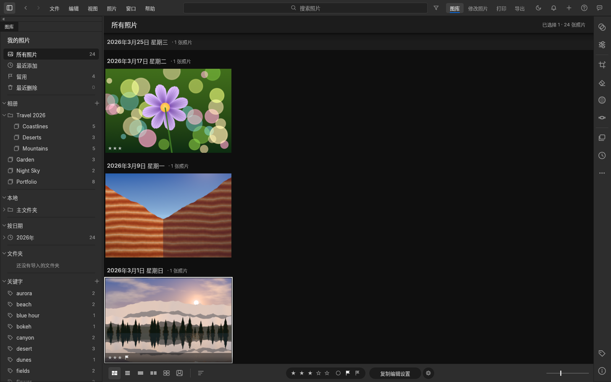
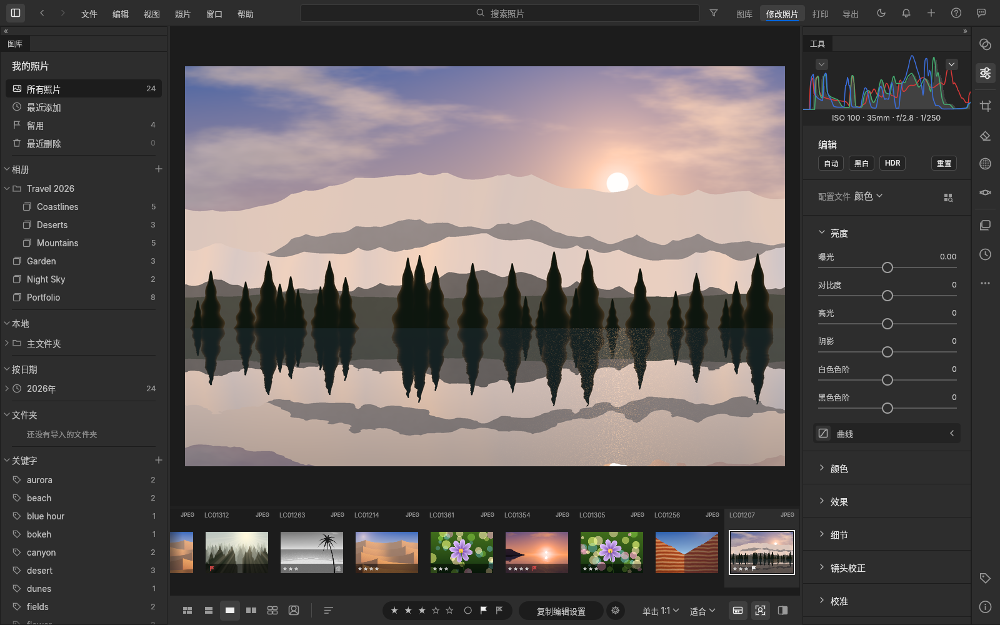
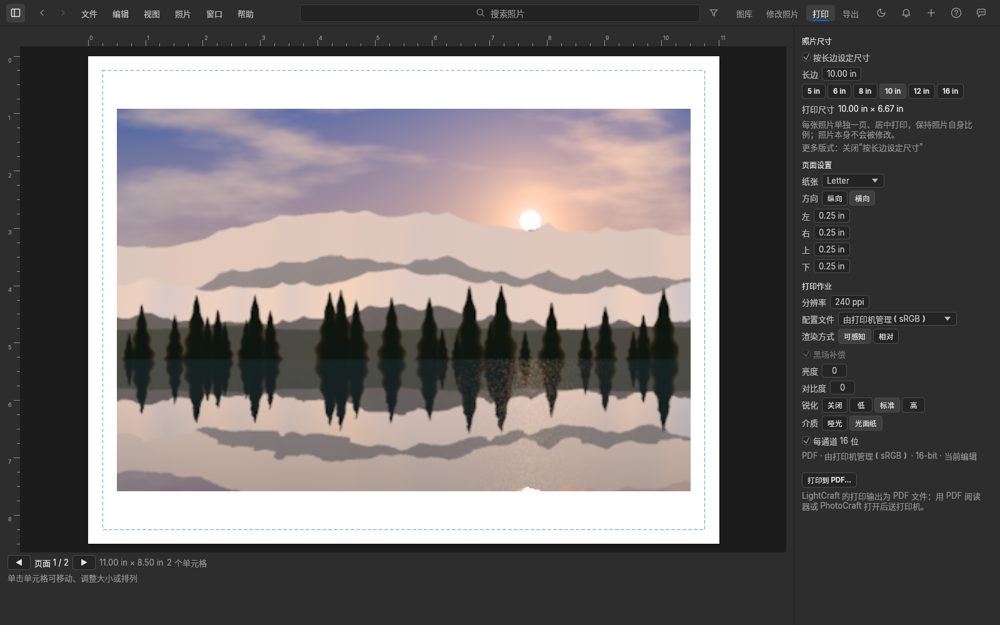
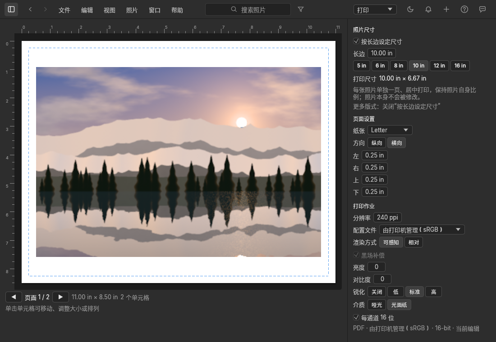

# LightCraft 附加扩展（Lightroom Classic 式模块栏 + 打印模块）

这是给 [LightCraft](https://github.com/storytold/lightcraft) 打的一组补丁和一个构建脚本。它在**官方发布版 v0.20.0** 上加了下面这些功能，引擎、照片数据和图库格式都不动。

- **顶栏右上角的模块栏：图库｜修改照片｜打印｜导出**，操作逻辑沿用 Lightroom：
  - **图库**：照片网格和左侧面板，用来选图、打星、加旗标；
  - **修改照片**：放大视图加 Edit 调整面板，已经在用的裁剪、蒙版、移除等工具会保持打开；
  - **打印**：整个窗口显示打印设置和页面预览，见下文；
  - **导出**：打开导出对话框。
  - 快捷键和 Lightroom Classic 一致：Ctrl/⌘+Alt+1 图库，Ctrl/⌘+Alt+2 修改照片，Ctrl/⌘+Alt+6 打印。“窗口”菜单里也能切换，当前模块会打勾。
- **打印模块**
  - **照片尺寸 ▸ 按长边设定尺寸**：默认开启，长边 **10 英寸**。每张照片单独一页、居中，保持自己裁剪后的比例。只改打印版面，**不改照片本身**：调整、裁剪、文件都不变。
    - 可以直接输入长边，或点 5 / 6 / 8 / 10 / 12 / 16 英寸快捷按钮；
    - 右侧会显示实际打印尺寸，例如 10.00 × 6.67 in；
    - 纸张放不下时会等比缩小并给出提示。
  - **纵向 / 横向**、纸张大小、页边距。
  - **色彩管理**：打印机/纸张 ICC 配置文件，或“由打印机管理（sRGB / Adobe RGB）”；渲染方式（可感知 / 相对）；黑场补偿；打印亮度和对比度；打印锐化（介质：哑光 / 光面）；16 位输出；分辨率。
  - 关闭“按长边设定尺寸”后，LightCraft 原有的全部打印版式都会出现：单张、联系表、图片包、自定义，另有模板、参考线等。
- **中文打印界面**：补齐了打印界面的简体和繁体中文。原来 “Paper” 被译成“纸白”，纸张方向显示成“人像 / 横向”，现在分别是“纸张”和“纵向 / 横向”。
- **启动时不再自动检查官方更新**：官方版本没有这些功能，更新会把它们覆盖掉。升级方法见下文。“帮助 ▸ 检查更新”手动入口仍在，但安装它就会回到官方版。
- **支持打开 HEIC/HEIF 照片**：和官方发布版一致。上游默认不开启，是出于 HEVC 专利方面的考虑，让发行方自己决定；构建脚本按官方发布版的做法开启它。

| 图库 | 修改照片 |
|---|---|
|  |  |
| **打印**：横向 Letter 纸，长边 10 英寸，居中 | **窗口较窄时**：模块栏收成一个下拉按钮 |
|  |  |

截图由命令行工具在无界面模式下渲染，用的是演示图库，界面语言为简体中文。

> **关于打印输出**：LightCraft 的打印目前只能输出 **PDF**（16 位，嵌入 ICC 配置文件）。“打印到 PDF…”之后，用系统的 PDF 阅读器（macOS 预览、Adobe Acrobat）或 PhotoCraft 打开再送打印机。**在打印对话框里一定要选“实际大小 / 100%”，不要选“适合页面”**，否则 10 英寸会被缩放。

## 构建和安装

需要：Git，以及 Rust 工具链（安装 [rustup](https://rustup.rs) 即可，要求 Rust 1.95 或更高）。macOS 还要 Xcode 命令行工具（`xcode-select --install`），Windows 还要 Visual Studio C++ 生成工具。

首次构建会下载源码和依赖，4 核电脑大约要 30–60 分钟，`build/` 目录会占用约 10 GB。

### macOS

```bash
git clone -b ccr-45d7b05e-5o74gq https://github.com/2751833085/LightCraft-additional-extensions
cd LightCraft-additional-extensions
scripts/build.sh --package
```

完成后打开 `build/lightcraft/dist/release/` 里的 `.dmg`，把 LightCraft 拖进“应用程序”。

这个 DMG 是本机自签名（ad-hoc）的，只能在构建它的这台 Mac 上直接打开。第一次打开如果被系统拦截，在“系统设置 ▸ 隐私与安全性”里点“仍要打开”。

只想直接运行、不打包：`scripts/build.sh`，然后运行 `build/lightcraft/target/release/lightcraft`。

### Windows（PowerShell）

```powershell
git clone -b ccr-45d7b05e-5o74gq https://github.com/2751833085/LightCraft-additional-extensions
cd LightCraft-additional-extensions
powershell -ExecutionPolicy Bypass -File scripts\build.ps1
```

程序在 `build\lightcraft\target\release\lightcraft.exe`。

### Linux

```bash
scripts/build.sh            # 生成 build/lightcraft/target/release/lightcraft
scripts/build.sh --package  # 另外打成 tar.gz，放在 build/lightcraft/dist/release/
```

## 使用

1. **图库**：点右上角“图库”（或按 Ctrl/⌘+Alt+1），在网格里选照片。
2. **修改照片**：点“修改照片”（Ctrl/⌘+Alt+2）进入调整面板。各项操作和 LightCraft 原来一样。
3. **打印**：
   - 先在图库里选好要打印的照片（可以多张，每张一页），然后点“打印”（Ctrl/⌘+Alt+6）；
   - 右侧“照片尺寸”默认按长边 10 英寸。需要别的尺寸，就改“长边”或点快捷按钮；
   - 在“页面设置”里选纸张和纵向/横向，在“打印作业”里选配置文件和渲染方式；
   - 点“打印到 PDF…”保存 PDF，再从 PDF 阅读器按“实际大小”打印；
   - 打印模块里按 ← / → 翻页（不会改变选择）。按 Esc、G/D/E 这类视图快捷键，或点别的模块，就会离开打印模块；离开时 LightCraft 原来的打印版面会还原，所以 文件 ▸ 打印…（⌘P）仍然打印当前选中的照片；
   - 一次最多排 50 张（每张一页）。超出的张数，或者因为太窄、太小而放不下的照片，会在“照片尺寸”下方用提示列出。
4. **导出**：点“导出”打开导出对话框。

图库与同版本的官方 LightCraft 完全通用，补丁不改图库格式。但请不要用**更新版本**的官方 LightCraft 打开过图库后，再回到本构建：新版可能会升级图库格式。

## 升级到新的 LightCraft 版本

1. 把 `upstream.lock` 里的 `UPSTREAM_TAG` / `UPSTREAM_COMMIT` 改成新的发布版，例如 v0.21.0 及其提交号；`CRAFT_FONTS_REV` 改成新版 `.github/workflows/release.yml` 里的 `craft-fonts-ref`。
2. 重新运行 `scripts/build.sh`。补丁如果应用失败，说明上游改到了同一处代码，需要更新 `patches/`。
3. 用新构建替换旧的应用。

## 已验证 / 未验证

已在本次开发环境（Linux x86_64，4 核）实际运行并通过的：

- **上游界面层完整测试套件**，跑了两轮，都是 0 失败：
  - 第一轮：库内 1923 个、集成测试 32 个、关闭测试 1 个；
  - 第二轮（修复代码审查发现的问题之后）：库内 1929 个，多出来的是新增的回归测试，另有集成 32 个、关闭 1 个。

  本补丁一共新增 13 个测试：模块切换、按长边排版、离开打印模块后还原版面、方向键翻页、窄窗口折叠、中文名称等。
- **`scripts/build.sh` 端到端两次**：
  - 第一次在全新目录里：取 v0.20.0 → 校验提交号 → 打补丁 → 取中文字体 → release 编译，约 20 分钟；
  - 第二次在同一目录重复运行，并开启 HEIC 支持，约 4 分钟。
- **无界面截图**：上面四张。
- **打印到 PDF 的实际尺寸**：横向 Letter 纸上选两张 3:2 照片，导出的 PDF 有 2 页，页面 792 × 612 pt。每页照片区域 2400 × 1600 像素（240 ppi），即 **10.000 × 6.667 英寸**，水平和垂直都居中，16 位。

没有实际运行的：

- macOS 和 Windows 上的构建与打包：`scripts/build.sh --package` 在 macOS 上、`scripts/build.ps1`，都按上游打包脚本和审查结果编写，但没有在这两个系统上跑过；
- 真机打印到打印机；
- 带图形界面的手动操作：截图和测试都在无界面模式下进行。

## 仓库结构

| 路径 | 内容 |
|---|---|
| `patches/0001-*.patch` | 模块栏、打印模块、按长边设定尺寸、中文翻译和测试 |
| `patches/0002-*.patch` | 启动时不检查官方更新 |
| `upstream.lock` | 补丁对应的上游发布版和中文字体版本 |
| `scripts/build.sh` / `scripts/build.ps1` | 获取源码 → 校验版本 → 打补丁 → 获取中文字体 → 编译或打包 |
| `docs/lrc-workflow-and-retouch-tools.zh-CN.md` | 从 LrC + PS 迁移：修改前/修改后、导出后用 PS 打开、快捷键、PhotoCraft、减淡/加深等修图工具，以及后续补丁建议 |
| `docs/research-raw-formats-and-extensions.zh-CN.md` | 理光 / 飞思 IIQ / 适马 X3F 支持与扩展方案 |
| `docs/screenshots/`、`docs/research-data/` | 截图；原始调研数据（含核查结论） |

## 改动范围

所有改动都在界面层（`crates/ui-egui`），另外在 `apps/lightcraft/src/main.rs` 改了一行（关闭启动时的更新检查）。

- 新增文件：`panels/modules.rs`（模块栏）、`panels/print_module.rs`（打印模块）、`tests/modules.rs`（测试）。
- 修改的上游文件：顶栏、窗口布局、打印对话框（拆出可复用的“页面设置”和“打印作业”段落，并给标签加翻译上下文）、命令表和菜单、状态和设置、中文语言包。
- 打印版面通过 LightCraft 自己的 `print.*` 命令生成，没有改打印引擎和渲染管线。
